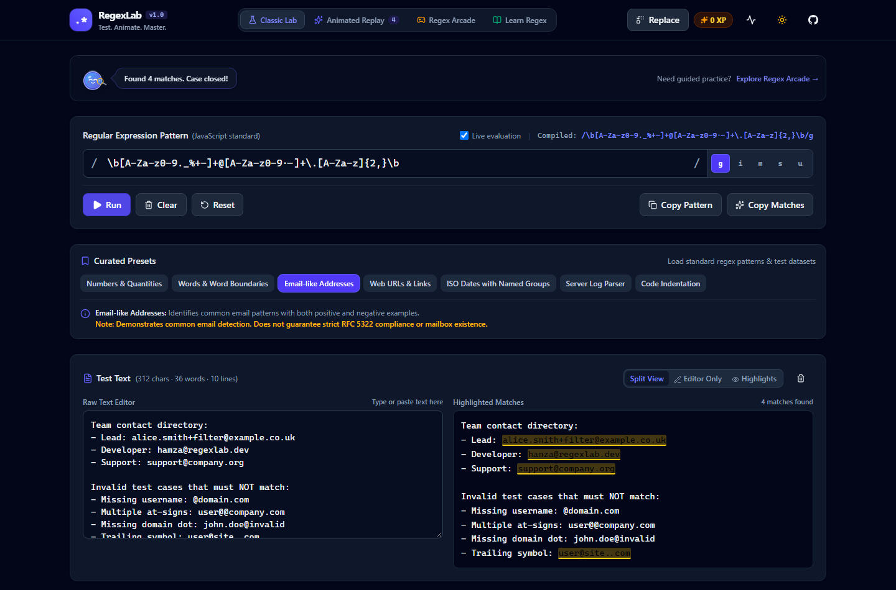
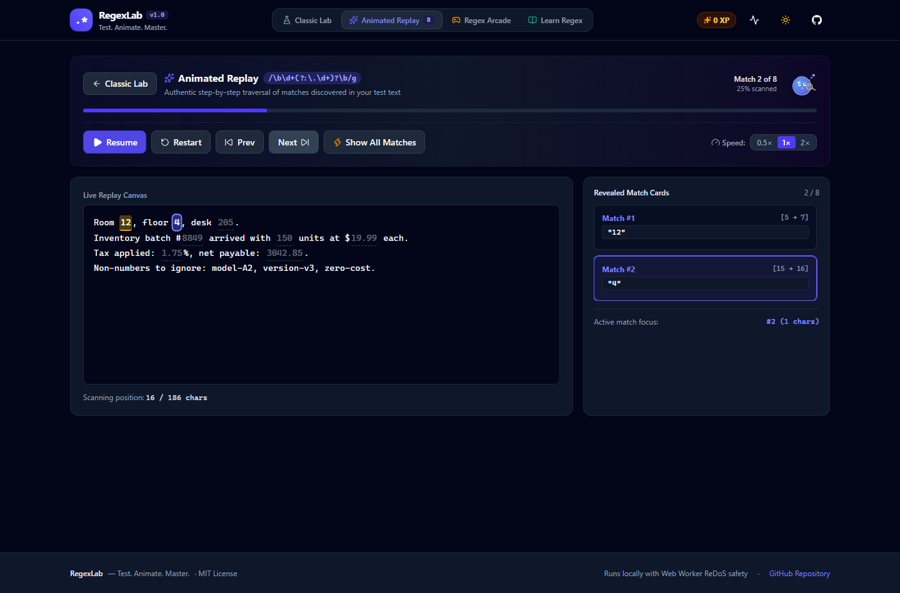
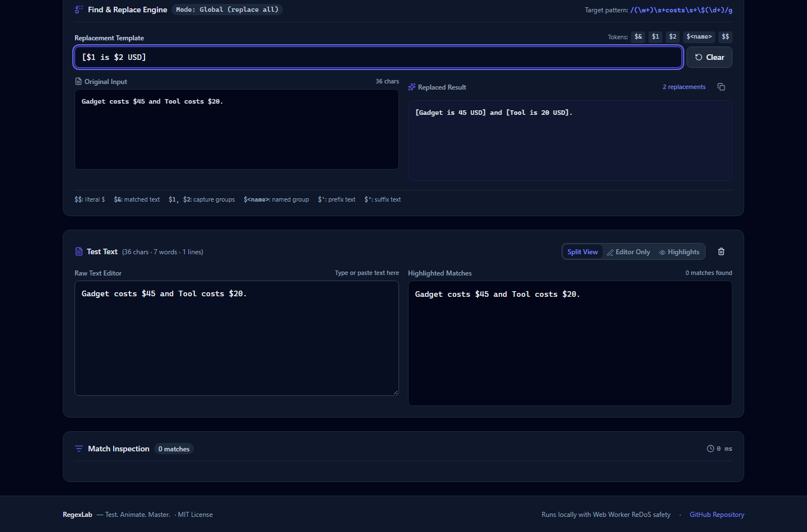
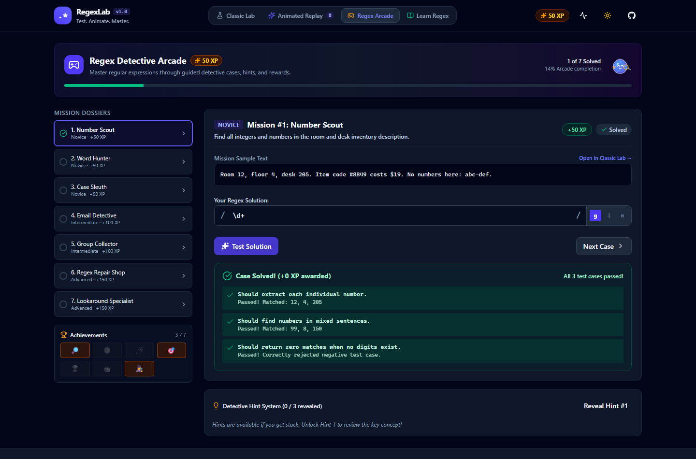
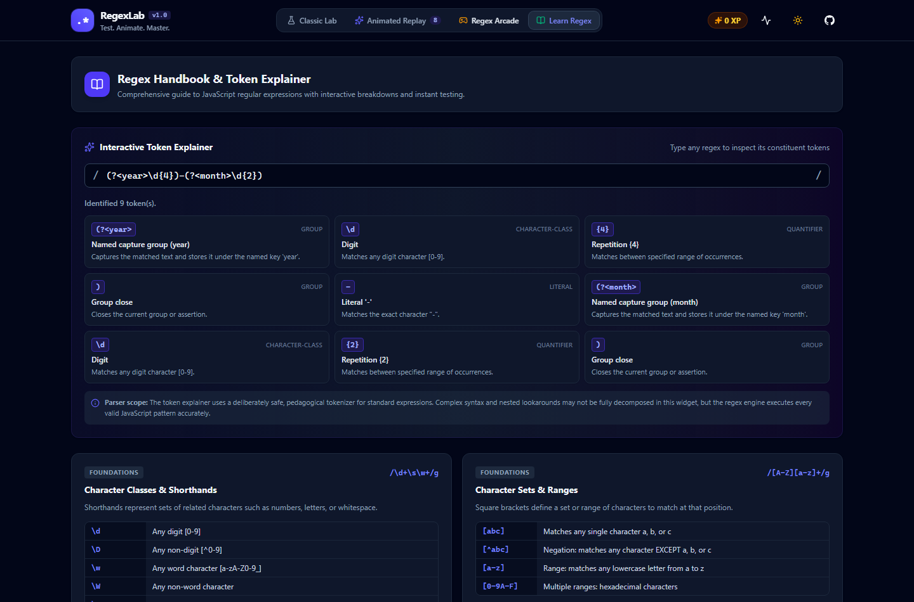
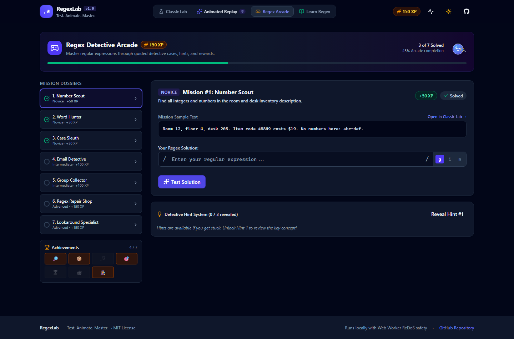

# RegexLab — Test. Animate. Master.

[](https://github.com/Hafiz-Hamza-Liaqat/regexlab/actions/workflows/ci.yml)
[](https://github.com/Hafiz-Hamza-Liaqat/regexlab/actions/workflows/pages.yml)
[](LICENSE)
[](https://www.typescriptlang.org/)
[](https://playwright.dev/)

**RegexLab** is a fast browser application that bridges professional regex testing, authentic animated text analysis, and interactive gamified regex learning.

- **Live Application:** [https://hafiz-hamza-liaqat.github.io/regexlab/](https://hafiz-hamza-liaqat.github.io/regexlab/)
- **Repository:** [https://github.com/Hafiz-Hamza-Liaqat/regexlab](https://github.com/Hafiz-Hamza-Liaqat/regexlab)

---

## Table of Contents

- [Three Connected Experiences](#three-connected-experiences)
  - [1. Classic Lab](#1-classic-lab--professional-regex-testing)
  - [2. Animated Replay](#2-signature-feature--animated-replay)
  - [3. Regex Arcade](#3-regex-arcade--learn-by-playing)
- [Find & Replace Engine](#find--replace-engine)
- [Dot — The Regex Detective Mascot](#dot--the-regex-detective-mascot)
- [Safe Execution Architecture & Privacy](#safe-execution-architecture--privacy)
- [Supported Flags & JavaScript Compatibility](#supported-flags--javascript-compatibility)
- [Known Regex-Explanation Limitations](#known-regex-explanation-limitations)
- [Screenshots & Visual Tour](#screenshots--visual-tour)
- [Getting Started & Local Development](#getting-started--local-development)
- [Verification & Quality Gates](#verification--quality-gates)
- [Deployment & GitHub Pages](#deployment--github-pages)
- [License](#license)

---

## Three Connected Experiences

RegexLab is purposefully designed around three connected workflows:

### 1. Classic Lab — Professional Regex Testing

Designed for everyday developer productivity, debugging, and experimentation without distractions:

- **Pattern Editor:** Full-featured regex input with compiled expression preview (`/pattern/flags`), clear validation error messaging, debounced live evaluation toggle, and convenient copy actions.
- **Accessible Flag Controls:** Instant toggles for `g` (global), `i` (ignore case), `m` (multiline), `s` (dotAll), and `u` (unicode).
- **Test-Text Workspace:** Multiline editor with word, character, and line counters, alongside split view or dedicated highlighted match view.
- **Match Inspector:** Displays total matches, execution duration in milliseconds, and cards detailing:
  - 0-based start and end character offsets (`Index: start → end`)
  - Full matched string
  - Context snippet with prefix and suffix characters
  - Numbered capture groups (`$1`, `$2`, etc.)
  - Named capture groups (`$<name>`)
- **Curated Datasets:** Preloaded datasets covering decimal numbers, word boundaries, email-like strings, URLs, ISO dates with named groups, structured server logs, and code indentation.

### 2. Signature Feature — Animated Replay

RegexLab's defining feature is an authentic, step-by-step match replay engine:

- **Real Execution Results:** Calculates genuine match results via a dedicated Web Worker; never fabricates results for visual effect.
- **Scanning Cursor:** Sweeps across the test text to visualize how the regex engine discovers matches.
- **Progressive Highlight & Card Stream:** Highlights each match with a subtle glow transition while synchronously revealing corresponding match cards, offsets, and capture groups.
- **Replay Controls:** Play, pause, restart, step forward (next match), step backward (prev match), speed adjustment (`0.5×`, `1×`, `2×`), and "Show All Matches" for instant reveals.
- **Accessibility & Motion Preference:** Full support for `prefers-reduced-motion` and a manual reduced-motion toggle that immediately bypasses animations.

### 3. Regex Arcade — Learn by Playing

Guided detective missions that transform regular expression concepts into rewarding games:

- **7 Progressive Missions Across 3 Difficulty Tiers:**
  1. *Number Scout (Novice)*: Extract all numeric quantities using `\d+`.
  2. *Word Hunter (Novice)*: Match standalone words while avoiding substring matches using `\b`.
  3. *Case Sleuth (Novice)*: Match words regardless of capitalization using the `i` flag.
  4. *Email Detective (Intermediate)*: Distinguish valid email-like patterns from malformed strings.
  5. *Group Collector (Intermediate)*: Capture Year, Month, and Day components into distinct capture groups.
  6. *Regex Repair Shop (Advanced)*: Fix flawed expressions failing on equations or area codes.
  7. *Lookaround Specialist (Advanced)*: Extract price amounts preceded by `$` without consuming the dollar symbol using positive lookbehind `(?<=...)`.
- **Deterministic Grading:** Evaluates user patterns against positive (MUST match) and negative (MUST NOT match) test cases. Accepts **any** valid pattern meeting the criteria rather than requiring an exact reference string.
- **3-Tier Progressive Hint System:**
  - *Hint 1*: Core concept explanation.
  - *Hint 2*: Structural clue and syntax syntax guidance.
  - *Hint 3*: Full reference solution and breakdown.
- **Idempotent XP & Achievements:** Versioned local persistence (`regexlab_progress_v1`) ensuring achievements (*First Match*, *Capture Expert*, *Replacement Wizard*, *Arcade Rookie*, *Arcade Finisher*, *Regex Master*, *Detective Companion*) and XP rewards cannot be duplicated on reload or replay.

---

## Find & Replace Engine

RegexLab provides a dedicated Find & Replace panel following ECMAScript replacement semantics:

- **Standard Token Support:**
  - `$&`: The matched substring
  - `$1` .. `$99`: Numbered capture groups
  - `$<name>`: Named capture groups
  - `$$`: Literal dollar sign
  - `$\``: Portion of text preceding the match
  - `$'`: Portion of text following the match
- **Comparative Diff View:** Clear side-by-side presentation separating the original input from the replaced output with real-time replacement counters.
- **Flag Sensitivity:** Honors the `g` flag for global versus single-occurrence replacement.

---

## Dot — The Regex Detective Mascot

Original, custom SVG detective mascot **Dot** brings friendly guidance without being intrusive:

- **Expressive States:**
  - `idle`: Attentive detective observing input.
  - `scanning`: Focusing magnifying glass with beam sweeps.
  - `thinking`: Inspecting expression logic with thought bubbles.
  - `happy`: Smiling cheerfully on successful matches.
  - `confused`: Tilted detective hat and question mark on invalid patterns or zero results.
  - `champion`: Golden star badge and celebratory sparkles on solved missions.
- **Non-Intrusive Guidance:** Short contextual speech bubbles offering helpful tips when expressions fail or return zero matches.
- **Accessibility:** Hidden from assistive tools when purely decorative and equipped with semantic ARIA labels when conveying status.

---

## Safe Execution Architecture & Privacy

- **Dedicated Web Worker:** All matching and replacements run in `src/workers/regex.worker.ts`, keeping the main UI thread responsive.
- **Catastrophic Backtracking (ReDoS) Protection:** Enforces an execution deadline (default 2,000ms). When expired, the hung worker is immediately terminated (`worker.terminate()`), a fresh worker is spun up, and an informative timeout message is surfaced.
- **Zero-Length Match Protection:** In global mode, matches with zero length advance `lastIndex` safely by one code point (respecting Unicode surrogate pairs) to eliminate infinite loops.
- **Stale Request Discarding:** Every run is stamped with a unique `requestId`; outdated results from prior edits are discarded.
- **Local Privacy Model:** 100% of regex execution, text processing, and progress storage occurs locally in your browser. No server backend, no authentication, no analytics, no external APIs, and no telemetry. Test text is never stored in persistent storage.

---

## Supported Flags & JavaScript Compatibility

RegexLab evaluates regular expressions using standard JavaScript `RegExp`:

| Flag | Name | Behavior |
|:---:|:---|:---|
| `g` | Global | Find all matches in the text rather than stopping after the first match. |
| `i` | Ignore Case | Case-insensitive matching (`A-Z` matches `a-z`). |
| `m` | Multiline | `^` and `$` match the start and end of every line in addition to the input string. |
| `s` | DotAll | The `.` wildcard matches all characters including newline characters (`\n`, `\r`). |
| `u` | Unicode | Treats pattern as Unicode code points, handling surrogate pairs correctly. |

---

## Known Regex-Explanation Limitations

The **Learn Regex** interactive token explainer is intentionally built with a safe, pedagogical parser designed for clarity and education:

- It decomposes character classes (`\d`, `\w`, `\s`), brackets (`[...]`, `[^...]`), quantifiers (`*`, `+`, `?`, `{n,m}`), anchors (`^`, `$`, `\b`), alternation (`|`), capturing and named groups, and basic lookarounds.
- Extremely nested assertions, recursive constructs, or non-standard syntax may not be fully decomposed by this limited parser.
- The explainer displays a clear notice when uninterpreted elements are present.
- The execution engine itself runs full ECMAScript `RegExp`, so valid patterns work seamlessly regardless of whether the explainer decomposes every token.

---

## Screenshots & Visual Tour

Genuine screenshots captured from the live running application:

### 1. Classic Lab with Highlighted Matches


### 2. Animated Replay Stage


### 3. Find & Replace Engine


### 4. Regex Arcade Mission in Progress


### 5. Learning Handbook & Interactive Token Explainer


### 6. Detective Mascot & Achievements Collection


---

## Getting Started & Local Development

### Prerequisites

- Node.js 20+ (Node 22 recommended)
- npm 10+

### Installation

```bash
git clone https://github.com/Hafiz-Hamza-Liaqat/regexlab.git
cd regexlab
npm install
```

### Development Server

```bash
npm run dev
```

Opens Vite development server with Hot Module Replacement at `http://localhost:5173`.

### Production Build

```bash
npm run build
```

Compiles TypeScript and creates optimized static assets in `dist/`.

---

## Verification & Quality Gates

Run all quality checks in one command:

```bash
npm run check
```

This runs:
1. `npm run lint` — Oxlint and ESLint checks (0 errors, 0 warnings).
2. `npm run typecheck` — TypeScript strict typecheck (`tsc -b`).
3. `npm run test:run` — Vitest unit & component test suite (57 passing tests).

### Playwright End-to-End Tests

```bash
npm run test:e2e
```

Executes 18 comprehensive browser automation tests covering:
- Normal and edge-case regex matching
- Capture groups and named groups inspection
- Flag toggling and presets
- Find & Replace transformations
- Replay controls (play, pause, next, prev, speed, reveal all)
- Arcade mission solving, idempotent rewards, hint progression
- Theme and reduced-motion toggling
- Viewport layouts at 375px, 768px, 1024px, and 1440px with zero horizontal overflow

### Build Verification for GitHub Pages

```bash
npm run verify:build
```

Ensures all generated bundles and assets in `dist/index.html` strictly reference `/regexlab/assets/` and exist on disk with non-zero file sizes.

### Screenshot Capture Script

```bash
npm run capture:screenshots
```

Starts Vite, launches Playwright Chromium headless, and captures genuine 1440px dark-theme screenshots to `docs/screenshots/`.

---

## Deployment & GitHub Pages

RegexLab is automated with two GitHub Actions workflows:

1. **`ci.yml`**: Runs on every push and pull request to `main`, validating linting, typechecks, tests, and production build.
2. **`pages.yml`**: Builds with `BASE_PATH=/regexlab/`, verifies asset paths using `verify-build.mjs`, and deploys the static site to GitHub Pages.

---

## License

This project is licensed under the [MIT License](LICENSE).
Copyright (c) 2026 Hamza Liaqat.
